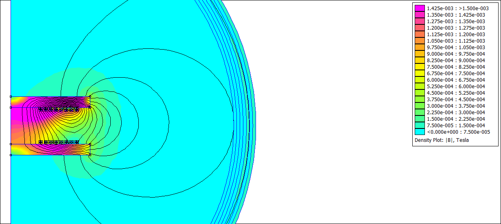

# WPT Coil Designer & Analyzer

[](https://www.python.org/)
[](https://github.com/ExsTima/wpt-coil-designer/actions/workflows/ci.yml)
[](LICENSE)
[]()
[](https://www.femm.info/)

Инженерный программный комплекс для электродинамического расчёта, анализа высокочастотных потерь, моделирования топологии SS-резонанса и кросс-верификации систем беспроводной передачи энергии (Wireless Power Transfer, WPT) с конечно-элементным решателем **FEMM 4.2**.

---

## 📌 Ключевые возможности

1. **Аналитический расчёт индуктивностей (Real-time):**
   * Расчёт взаимной и собственной индуктивностей планарных катушек произвольной геометрии через полные эллиптические интегралы Лежандра 1-го и 2-го рода $K(k)$ и $E(k)$ (формула Максвелла).
   * Численный интеграл Неймана для учёта радиального и углового смещения катушек ($\Delta x, \Delta y$).
   * Учёт ферритовых концентраторов магнитного потока методом зеркальных отображений (Method of Images) для системы двух параллельных полубесконечных плоскостей.

2. **Моделирование высокочастотных потерь в литцендрате:**
   * Точный аналитический учёт поверхностного эффекта (Skin Effect) в единичной жиле через функции Кельвина первого рода ($\mathrm{ber}$, $\mathrm{bei}$, $\mathrm{ber}'$, $\mathrm{bei}'$).
   * Расчёт эффекта близости (Proximity Effect) от поперечного поля соседних витков и ферритовых изображений.

3. **Схемотехнический решатель контуров (SS-топология):**
   * Анализ методом первой гармоники (First Harmonic Approximation, FHA).
   * Расчёт бифуркации и расщепления резонансных частот (критический коэффициент связи $k_{\text{crit}}$).
   * Автоматический трекинг частоты для работы в безопасной области ZVS (Zero Voltage Switching).
   * Расчёт баланса мощностей ($P_{\text{in}}, P_{\text{out}}, P_{\text{cu}}, P_{\text{mos}}$) и КПД ($\eta$).

4. **Визуализация магнитных полей:**
   * Распределение вектора магнитной индукции $\mathbf{B}(x, z)$ в 2D и 3D (закон Био-Савара-Лапласа).
   * Построение линий магнитной индукции через скалярную функцию магнитного потока $\Psi(r, z) = r \cdot A_{\phi}(r, z)$, гарантирующую замкнутость силовых линий ($\nabla \cdot \mathbf{B} = 0$).

5. **Автоматизированная верификация в МКЭ (FEMM 4.2):**
   * Генерация осесимметричной задачи (`.fem`), задание свойств литцендрата, ферритов Mn-Zn и асимптотических граничных условий (ABC).
   * Двухпрогонный запуск решателя FEMM через COM/ActiveX API (`pyfemm`) для независимого извлечения $L_1, L_2, M, k, R_{\text{ac}}$.
   * Сопоставление аналитической модели и численного расчёта МКЭ с протоколированием погрешности ($< 3\%$ по взаимной индуктивности $M$).

6. **Профессиональный инженерный интерфейс (GUI v2.0):**
   * Единая дизайн-система на базе палитры Tailwind Slate/Zinc: высокий контраст, тонкие разделители и единая модульная сетка.
   * **Экспресс-панель KPI** прямо на вкладке параметров: мгновенное отображение $\eta, P_{\text{вых}}, k, f_{\text{комм}}$ без необходимости переключения вкладок.
   * **Инженерные пресеты** в один клик: стандарт Qi v1.2 (5 Вт), GaN WPT (24 В, 50 Вт, 500 кГц), SAE J2954 EV (3.3 кВт, 85 кГц), FEMM 4.2 Benchmark.
   * **Интерактивный зонд (Gaussmeter Probe)** на 2D-карте поля: считывание $(x, z)$ и индукции $|B|$ под курсором в реальном времени.
   * **Контроль физических инвариантов**: визуализатор баланса мощности $P_{\text{in}} = P_{\text{out}} + \sum P_{\text{losses}}$ с контролем невязки до $10^{-7}$ Вт.
   * Современные тёмные всплывающие подсказки (Dark Slate Tooltips) и публикационная графика Matplotlib с LaTeX-нотацией.

---

## 🔬 Математический аппарат

### 1. Взаимная индуктивность коаксиальных витков (формула Максвелла)

Взаимная индуктивность $M_{ij}$ между двумя круглыми нитевидными витками радиусов $R_i$ и $R_j$, разделёнными осевым расстоянием $\Delta z$:

$$M_{ij} = \mu_0 \sqrt{R_i R_j} \left[ \left(\frac{2}{k_e} - k_e\right) K(m) - \frac{2}{k_e} E(m) \right]$$

где модуль эллиптических интегралов $m = k_e^2$:

$$m = \frac{4 R_i R_j}{(R_i + R_j)^2 + \Delta z^2}$$

Собственная индуктивность витка радиуса $R$ с круглым сечением пучка радиуса $a$:

$$L_{\text{self}} = \mu_0 R \left[ \ln\left(\frac{8R}{a}\right) - 2 + \frac{1}{4} \right]$$

### 2. Метод зеркальных отображений для ферритовых экранов

Для учёта влияния ферритовых пластин с магнитной проницаемостью $\mu_r \gg 1$ каждый виток отражается бесконечной серией мнимых токов с эффективным коэффициентом отражения $\rho$:

$$\rho = \frac{\mu_r - 1}{\mu_r + 1} \approx 0.60 \quad \text{(с учётом конечных размеров экрана)}$$

Координата $n$-го изображения витка с координатой $z$:

$$z_{\text{img}} = \mathrm{sign} \cdot z + \mathrm{shift}, \quad w = \rho^{|2n|}$$

### 3. Высокочастотные потери в литцендрате (Skin & Proximity effects)

Активное сопротивление проводника складывается из сопротивления постоянному току $R_{\text{dc}}$, скин-эффекта и эффекта близости:

$$R_{\text{ac}} = R_{\text{dc}} \cdot F_{\text{skin}}(\xi) + R_{\text{prox}}$$

где $\xi = \frac{r_s}{\delta}$ — отношение радиуса единичной жилы к толщине скин-слоя $\delta = \sqrt{\frac{\rho_{\text{cu}}}{\pi f \mu_0}}$:

$$F_{\text{skin}}(\xi) = \frac{\sqrt{2}\xi}{2} \cdot \frac{\mathrm{ber}(\sqrt{2}\xi)\mathrm{bei}'(\sqrt{2}\xi) - \mathrm{bei}(\sqrt{2}\xi)\mathrm{ber}'(\sqrt{2}\xi)}{\left[\mathrm{ber}'(\sqrt{2}\xi)\right]^2 + \left[\mathrm{bei}'(\sqrt{2}\xi)\right]^2}$$

Потери от эффекта близости определяются геометрическим фактором $K_{\text{prox}} = \sum_i l_i \langle B_i^2 \rangle$:

$$R_{\text{prox}} = \frac{N_{\text{strands}} \pi \omega^2 (2 r_s)^4}{64 \rho_{\text{cu}}} \cdot \frac{K_{\text{prox}}}{1 + 0.1 \xi^2}$$

### 4. Уравнения связанных контуров SS-топологии

$$\begin{cases}
Z_1 I_1 + j\omega M I_2 = V_1 \\
j\omega M I_1 + Z_2 I_2 = 0
\end{cases}$$

где эквивалентное сопротивление нагрузки, приведенное к первой гармонике (FHA):

$$R_{\text{eq}} = \frac{8}{\pi^2} R_{\text{load}}$$

---

## 📊 Верификация: Аналитическая модель vs. МКЭ (FEMM 4.2)

Результаты эталонного расчёта для катушек $D_{\text{out}} = 50\text{ мм}$, $D_{\text{in}} = 20\text{ мм}$, $N = 12\text{ витков}$, провод — литцендрат $40 \times 0.1\text{ мм}$, зазор $d = 15\text{ мм}$, частота $f = 100\text{ кГц}$:

| Параметр | Аналитическая модель (Python) | Численный расчёт (FEMM 4.2) | Погрешность |
| :--- | :---: | :---: | :---: |
| **Индуктивность передатчика $L_1$** | $12.35\text{ мкГн}$ | $12.82\text{ мкГн}$ | **$3.67\%$** |
| **Индуктивность приёмника $L_2$** | $12.35\text{ мкГн}$ | $12.82\text{ мкГн}$ | **$3.67\%$** |
| **Взаимная индуктивность $M$ ($d=15\text{ мм}$)** | $2.41\text{ мкГн}$ | $2.45\text{ мкГн}$ | **$1.63\%$** |
| **Коэффициент магнитной связи $k$** | $0.1951$ | $0.1911$ | **$2.09\%$** |
| **ВЧ-сопротивление $R_{\text{ac}}$ ($100\text{ кГц}$)** | $148.2\text{ мОм}$ | $154.6\text{ мОм}$ | **$4.14\%$** |

> Сходимость результатов подтверждает адекватность аналитического ядра при значительно более высокой скорости расчёта (доли миллисекунды против секунд в МКЭ).



---

## 📂 Структура репозитория

```text
wpt-coil-designer/
├── .github/
│   └── workflows/
│       └── ci.yml               # GitHub Actions CI (ruff + pytest)
├── assets/                      # Скриншоты и графические ресурсы
│   ├── femm_verification_screenshot.png
│   ├── icon.ico
│   └── icon.png
├── examples/                    # Файлы эталонных постановок задач FEMM
│   └── wpt_auto_verification.fem
├── src/
│   └── wpt_designer/
│       ├── __init__.py          # Метаданные пакета
│       ├── main.py              # Точка входа приложения
│       ├── core/                # Аналитическое ядро (NumPy, SciPy)
│       │   ├── constants.py     # Физические константы и параметры материалов
│       │   ├── winding.py       # Геометрия спиральных катушек и раскладка витков
│       │   ├── inductance.py    # Эллиптические интегралы и метод зеркальных отображений
│       │   ├── ac_losses.py     # Моделирование скин-эффекта и эффекта близости
│       │   ├── circuit_ss.py    # Решение SS-цепи, бифуркация, трекинг частоты
│       │   ├── field.py         # Расчёт полей B(x,z), 3D-интерполяция и функция потока Psi
│       │   └── simulation.py    # Оркестрация расчётов, параметрические прогоны и отчёты
│       ├── verification/        # Модуль интеграции с FEMM 4.2
│       │   └── femm_runner.py   # Построение КЭ-сетки, запуск солвера, сбор данных
│       └── gui/                 # Пользовательский интерфейс Tkinter + Matplotlib
│           ├── app_window.py    # Координатор главного окна и телеметрии
│           ├── presets.py       # Инженерные пресеты (Qi, EV, GaN, FEMM, IoT)
│           ├── theme.py         # Цветовая палитра, типографика и стили графиков
│           ├── tooltip.py       # Интерактивные всплывающие подсказки
│           └── tabs/            # Модульные вкладки интерфейса (вкладки 1–7)
│               ├── input_tab.py
│               ├── results_tab.py
│               ├── distance_tab.py
│               ├── frequency_tab.py
│               ├── field_2d_tab.py
│               ├── field_3d_tab.py
│               └── femm_tab.py
├── tests/                       # Автоматические тесты
│   ├── test_core.py             # Тесты расчётного ядра
│   ├── test_invariants.py       # Физические инварианты и взаимность
│   ├── test_simulation.py       # Тесты оркестрации, АЧХ, 3D-поля и пресетов
│   └── test_gui.py              # Автоматическая проверка GUI
├── create_desktop_shortcut.bat  # Скрипт создания ярлыка на Рабочем столе
├── LICENSE                      # Лицензия MIT
├── main.py                      # Скрипт быстрого запуска
├── pyproject.toml               # Конфигурация пакета, pytest и ruff
├── requirements.txt             # Зависимости Python
├── run.bat                      # Автоматический лаунчер для Windows
├── .gitignore                   # Фильтр временных файлов и расчетных сеток
└── README.md                    # Инженерная документация
```

---

## 🚀 Быстрый запуск в 1 клик (Windows)

Для пользователей Windows предусмотрен **автоматический лаунчер**:
1. Скачайте/склонируйте репозиторий.
2. Запустите файл **`run.bat`**.
   * *При первом запуске лаунчер сам автоматически создаст виртуальное окружение и доустановит все необходимые библиотеки (NumPy, SciPy, Matplotlib и др.). Никаких ручных команд вводить не требуется!*
   * *Для создания ярлыка на Рабочем столе запустите скрипт `create_desktop_shortcut.bat`.*

---

## 🛠 Ручная установка и запуск

### Требования
* Python 3.10 или выше
* Операционная система: Windows (для верификации через FEMM 4.2), Linux / macOS (для аналитического ядра и GUI)
* *(Опционально)* Установленный [FEMM 4.2](https://www.femm.info/wiki/Download) для работы вкладки верификации

### 1. Клонирование репозитория
```bash
git clone https://github.com/ExsTima/wpt-coil-designer.git
cd wpt-coil-designer
```

### 2. Создание виртуального окружения и установка зависимостей
```bash
python -m venv .venv
# Активация окружения (Windows PowerShell):
.venv\Scripts\Activate.ps1
# (Linux/macOS):
# source .venv/bin/activate

pip install -e .
# Для разработки и запуска тестов/линтера:
# pip install -e ".[dev]"
```

### 3. Запуск приложения
```bash
python main.py
```
*или (после установки пакета):*
```bash
wpt-coil-designer
```
*или:*
```bash
python -m wpt_designer.main
```

### 4. Запуск автоматических тестов и линтера
```bash
pytest -v
ruff check src tests
```
*или стандартным `unittest`:*
```bash
python -m unittest discover -s tests -v
```

---

## 📜 Лицензия

Проект распространяется под лицензией MIT. Подробности см. в файле [LICENSE](LICENSE).
